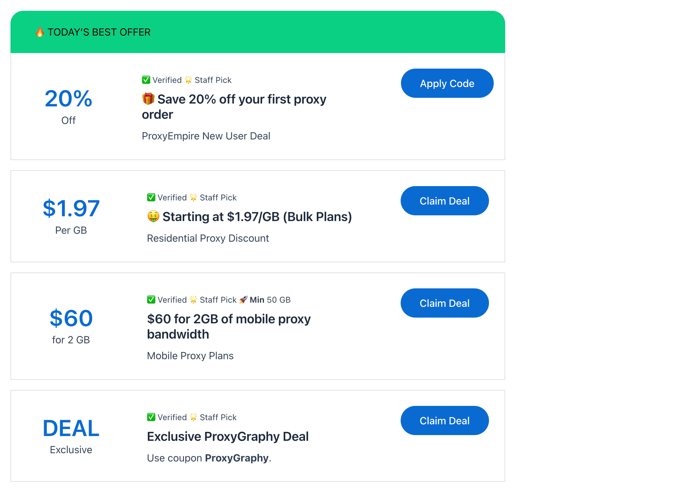

# ProxyEmpire Review and Coupon Codes – 🎯 Verified Deals: May 2025

ProxyEmpire has become a trusted name in the proxy space, especially among marketers, web scrapers, and data analysts. With premium residential, mobile, and ISP proxies, their infrastructure is fine-tuned for reliability, targeting precision, and low-block performance.

Whether you're managing ad verification, brand monitoring, or large-scale SEO scraping—ProxyEmpire delivers a suite of tools that meet real-world business demands.

---

## ProxyEmpire Coupons & Promo Highlights

| **PROXYEMPIRE COUPON OFFERS**      | **PROXYEMPIRE OFFER DETAILS**                                             | **PROMO CODE DETAILS**   |
|------------------------------------|---------------------------------------------------------------------------|---------------------------|
| ProxyEmpire New User Deal         | Save 20% off your first proxy order                                       | Auto-applied              |
| Residential Proxy Discount         | Starting at $1.97/GB (Bulk Plans)                                         | Auto-applied              |
| Mobile Proxy Plans                 | $60 for 2GB of mobile proxy bandwidth                                     | Auto-applied              |
| ISP Proxy Pricing                  | $2.50 per IP, available in regional packs                                 | Auto-applied              |
| Free Trial/Demo                    | Limited Trial Available Upon Request                                      | Request via Dashboard     |

[🎁 Get the Best Discount Auto-applied on ProxyEmpire Proxies](https://proxygraphy.com/aff/proxyempire)

---

## About ProxyEmpire

| **Feature**                | **Details**                                                                                                 |
|----------------------------|-------------------------------------------------------------------------------------------------------------|
| **Company Name**           | ProxyEmpire                                                                                                |
| **Official Website**       | [https://proxyempire.io](https://proxyempire.io)                                                            |
| **Proxy Types Offered**    | - Residential   - Mobile   - ISP (Static Residential)                                                  |
| **Protocols Supported**    | HTTP, HTTPS, SOCKS5                                                                                         |
| **Authentication Methods** | IP Whitelisting, Username:Password                                                                         |
| **Geo-Targeting**          | Country, State, City, ASN, ISP                                                                             |
| **Rotation Options**       | - Rotating (per request)   - Sticky Sessions (up to 60 minutes)                                         |
| **Concurrent Connections** | Unlimited                                                                                                  |
| **IP Pool Size**           | 30M+ Residential IPs   100,000+ Mobile IPs                                                                |
| **Session Control**        | Sticky sessions & TTL customization supported                                                              |
| **Use Case Suitability**   | - Scraping   - Market Research   - Brand Monitoring   - Ad Verification   - E-commerce Tracking |
| **Dashboard & API Access** | Yes – Clean UI with Full REST API                                                                          |
| **Pricing Structure**      | GB-based monthly plans, Pay-as-you-go for select proxy types                                               |
| **Free Trial**             | Available upon request (for select users)                                                                  |
| **Customer Support**       | Live Chat, Email Support, Help Center                                                                      |
| **Uptime & Performance**   | 99.9% Uptime SLA, Stable IPs, No Peer-to-Peer                                                              |
| **Refund Policy**          | Case-by-case refund within 3 days of purchase                                                              |

---

## ProxyEmpire Proxy Pricing Explained

ProxyEmpire has a tiered pricing system based on the type of proxy and volume purchased. They support trials for nearly all packages, starting at $1.97.

---

### 🏡 Rotating Residential Proxy Pricing

| **Plan Name**    | **GB**  | **Price per GB** | **Total Price** | **Trial**             |
|------------------|---------|------------------|------------------|------------------------|
| Pay As You Go    | 1 GB    | $7.00            | $7               | Start $1.97 Trial      |
| Starter          | 7 GB    | $5.71            | $40              | Start $1.97 Trial      |
| Hobby            | 28 GB   | $5.36            | $150             | Start $1.97 Trial      |
| Startup          | 60 GB   | $5.00            | $300             | Start $1.97 Trial      |
| Business         | 135 GB  | $4.44            | $600             | Start $1.97 Trial      |
| Company          | 315 GB  | $3.97            | $1,250           | Start $1.97 Trial      |
| Corporation      | 500 GB  | $3.50            | $1,750           | Start $1.97 Trial      |
| Enterprise       | 1000 GB | $3.00            | $3,000           | Start $1.97 Trial      |
| Custom Plans     | 2TB+    | Custom           | Contact Us       | Start $1.97 Trial      |

[🎁 Get the Best Discount Auto-applied on ProxyEmpire Proxies](https://proxygraphy.com/aff/proxyempire)

---

### 📱 Rotating Mobile Proxy Pricing

| **Plan Name**    | **GB**  | **Price per GB** | **Total Price** | **Trial**             |
|------------------|---------|------------------|------------------|------------------------|
| Pay As You Go    | 1 GB    | $9.00            | $9               | Start $1.97 Trial      |
| Mobile A         | 6 GB    | $8.33            | $50              | Start $1.97 Trial      |
| Mobile S         | 20 GB   | $7.50            | $150             | Start $1.97 Trial      |
| Mobile M         | 45 GB   | $6.67            | $300             | Start $1.97 Trial      |
| Mobile L         | 110 GB  | $5.91            | $650             | Start $1.97 Trial      |
| Mobile XL        | 300 GB  | $5.00            | $1,500           | Start $1.97 Trial      |
| Mobile 600 GB    | 600 GB  | $4.25            | $2,550           | Start $1.97 Trial      |
| Mobile 1000 GB   | 1000 GB | $4.00            | $4,000           | Start $1.97 Trial      |
| Custom Plans     | 1000+ GB| Custom           | Contact Us       | Start $1.97 Trial      |

[🎁 Get the Best Discount Auto-applied on ProxyEmpire Proxies](https://proxygraphy.com/aff/proxyempire)

---

### 📶 Dedicated Mobile Proxy Pricing

| **Plan Name**             | **Price**       | **Features**                                                | **Trial**         |
|---------------------------|------------------|--------------------------------------------------------------|--------------------|
| USA 5G Mobile Proxies     | $250/month       | Access to all 52 locations in 38 US states   Instant IP rotation | Get Started        |
| Multi-Country Package     | $125/month       | USA (NY, Miami, Texas), Israel, UK, Austria   IP rotates 4-5 times/day | Get Started |

---

## Key Features of ProxyEmpire

Here’s why ProxyEmpire’s infrastructure is loved by both individual scrapers and enterprise-grade users:

- 🌍 **Global Residential IPs** – Clean, ethically sourced proxies from 150+ countries
- 📱 **Real Mobile Proxies** – Powered by genuine 4G/LTE devices, not emulated
- 🔁 **Sticky or Rotating Sessions** – Choose session persistence per task
- 🧠 **Advanced Geo Targeting** – Drill down to specific ASN, carrier, or region
- 🧩 **Tool Compatibility** – Works seamlessly with Octo Browser, Puppeteer, AdsPower
- 🧼 **No Peer-to-Peer** – All proxies are ethically sourced from direct supply chains

---

## Why Choose ProxyEmpire?

ProxyEmpire is for users who want **clean, reliable proxies without the risks** often tied to peer-to-peer networks. Here's what makes it standout:

- ✅ **Ethically Sourced IPs**: All IPs are acquired directly via partnerships, never from shady P2P models.
- ✅ **Precise Targeting**: Get proxies filtered by country, city, ASN, or mobile carrier.
- ✅ **Multiple Proxy Types**: Offers Residential, Mobile, and ISP proxies—all under one dashboard.
- ✅ **Enterprise-Friendly**: Custom plans, dedicated account managers, and priority support for scaling teams.
- ✅ **Clean Traffic**: Low abuse rates and high success rates—perfect for scraping and automation tools.

[🎁 Get the Best Discount Auto-applied on ProxyEmpire Proxies](https://proxygraphy.com/aff/proxyempire)

---

## How ProxyEmpire Sources IP Addresses

ProxyEmpire ensures 100% transparency in how they build their IP pool:

- 🏢 **Direct Sourcing** – All residential and ISP proxies are leased or provided via regional partnerships.
- 🚫 **No P2P Networks** – Avoids the instability of peer-sourced networks.
- 📶 **Mobile from Real Devices** – Their mobile proxies run on actual smartphones connected via 4G/LTE.
- 🛡️ **Compliance First** – GDPR-aligned, with audit logs for corporate clients.

This ethical approach ensures **clean, high-quality traffic** that passes through far fewer security blocks.

---

## Proxy Trial Options

| **Trial Plan**           | **Details**                                                                 |
|--------------------------|------------------------------------------------------------------------------|
| Basic Demo               | Contact support for sample access                                            |
| Residential Trial        | Available on request (limited to 1 GB or less)                               |
| Mobile Trial             | Ask for customized mobile demo based on country                             |

---

## Popular Proxy Locations

| **Country**       | **Proxy Types Available**         |
|------------------|------------------------------------|
| United States    | Residential, Mobile, ISP           |
| United Kingdom   | Residential, ISP                   |
| Germany          | Residential, Mobile                |
| France           | Residential                        |
| India            | Residential, ISP                   |
| Canada           | Residential, Mobile                |
| Brazil           | Residential                        |

---

## ProxyEmpire Comparison with Other Proxy Providers

### 🔄 Side-by-side Comparison with Smartproxy

| **Feature**        | **ProxyEmpire**                 | **Smartproxy**                        |
|--------------------|----------------------------------|----------------------------------------|
| IP Pool            | 30M+                              | 40M+                                   |
| Proxy Types        | Residential, Mobile, ISP         | Residential, Datacenter                |
| Targeting          | ASN, ISP, City                   | City, State, Country                   |
| Mobile Proxies     | ✅ Yes                           | ❌ No                                   |
| SOCKS5 Support     | ✅ Yes                           | ✅ Yes                                  |
| Free Trial         | ✅ By request                    | ❌ No (paid trial)                      |

[🎁 Get the Best Discount Auto-applied on ProxyEmpire Proxies](https://proxygraphy.com/aff/proxyempire)

---

### 🔄 Side-by-side Comparison with Oxylabs

| **Feature**        | **ProxyEmpire**                 | **Oxylabs**                            |
|--------------------|----------------------------------|----------------------------------------|
| Residential Pool   | 30M+                              | 100M+                                   |
| Proxy Types        | Resi, Mobile, ISP                | Resi, DC, Web Unblocker                 |
| Mobile Proxies     | ✅ Yes                           | ✅ Yes                                   |
| Rotation Options   | Sticky + Rotating                | Sticky + Rotating                       |
| Pricing            | Lower, SMB-friendly              | Enterprise-focused, premium-priced     |

[🎁 Get the Best Discount Auto-applied on ProxyEmpire Proxies](https://proxygraphy.com/aff/proxyempire)

---

### 🔄 Side-by-side Comparison with Bright Data

| **Feature**        | **ProxyEmpire**                 | **Bright Data**                        |
|--------------------|----------------------------------|----------------------------------------|
| Proxy Types        | Resi, ISP, Mobile                | Resi, DC, Mobile, Web Unlocker         |
| Entry Price        | $45/month (5GB)                  | Starts ~$300/month                     |
| Targeting          | Country, ISP, ASN                | Country, ASN, ZIP                      |
| SOCKS5             | ✅ Yes                           | ✅ Yes                                  |
| Trial Option       | ✅ Manual                        | ✅ Free trial (requires approval)       |

---

### 🔄 Side-by-side Comparison with PYPROXY

| **Feature**        | **ProxyEmpire**                 | **PYPROXY**                            |
|--------------------|----------------------------------|----------------------------------------|
| Pool Size          | 30M+                              | 90M+                                   |
| Mobile Proxies     | ✅ Yes                           | ✅ Yes                                  |
| Unlimited Plans    | ❌ Not Available                 | ✅ Daily Unlimited                      |
| SOCKS5 Support     | ✅ Yes                           | ✅ Yes                                  |
| Targeting Precision| High (ASN, ISP)                 | High (ASN, City, Carrier)              |

[🎁 Get the Best Discount Auto-applied on ProxyEmpire Proxies](https://proxygraphy.com/aff/proxyempire)
[✅ Check out our PYPROXY Review and Discount](https://github.com/proxygraphy/editorial/blob/main/wp/PYPROXY%20Review%20and%20Coupon%20Codes.md)

---

### 🔄 Side-by-side Comparison with NodeMaven

| **Feature**        | **ProxyEmpire**                 | **NodeMaven**                          |
|--------------------|----------------------------------|----------------------------------------|
| Proxy Types        | Resi, ISP, Mobile                | Residential, Datacenter                |
| IP Pool Size       | 30M+                              | Unknown (smaller)                      |
| SOCKS5             | ✅ Yes                           | ✅ Yes                                  |
| Web Unblocker      | ❌ Not offered                   | ✅ Offered                              |
| Targeting Options  | ASN, City                        | Country, City                          |

[🎁 Get the Best Discount Auto-applied on ProxyEmpire Proxies](https://proxygraphy.com/aff/proxyempire) 
[✅ Check out our NodeMaven Review and Discount](https://github.com/proxygraphy/editorial/blob/main/wp/NodeMaven%20Coupon%20Codes.md)

---

### 🔄 Side-by-side Comparison with IPRoyal

| **Feature**        | **ProxyEmpire**                 | **IPRoyal**                            |
|--------------------|----------------------------------|----------------------------------------|
| Proxy Types        | Residential, Mobile, ISP         | Residential, Mobile, Datacenter        |
| SOCKS5 Support     | ✅ Yes                           | ✅ Yes                                  |
| Trial Support      | ✅ Available by request          | ❌ Not offered                          |
| Targeting          | City, ASN, ISP                   | City-level only                        |
| Rotation Control   | ✅ Sticky + TTL                  | ✅ Up to 24h Sticky                    |

[🎁 Get the Best Discount Auto-applied on ProxyEmpire Proxies](https://proxygraphy.com/aff/proxyempire)
[✅ Check out our IPRoyal Review and Discount](https://github.com/proxygraphy/editorial/blob/main/wp/IPRoyal%20Coupons%20-%20Verified%20Deals.md)

---

### 🔄 Side-by-side Comparison with Geonode

| **Feature**        | **ProxyEmpire**                 | **Geonode**                            |
|--------------------|----------------------------------|----------------------------------------|
| Proxy Types        | Resi, Mobile, ISP                | Resi, Mobile, Datacenter               |
| IP Pool            | 30M+                              | 10M+                                   |
| Targeting Options  | ASN, Carrier, ISP                | Country, City, ASN                     |
| Bandwidth Rollover | ❌ No                            | ✅ Yes                                  |
| SOCKS5             | ✅ Yes                           | ⚠️ Limited                             |

[🎁 Get the Best Discount Auto-applied on ProxyEmpire Proxies](https://proxygraphy.com/aff/proxyempire)
[✅ Check out our Geonode Review and Discount](https://github.com/proxygraphy/editorial/blob/main/wp/Geonode%20Coupons%20-%20100%25%20Verified%20Coupon%20Codes.md)

---

## Final Thoughts

If you're after **clean, high-quality proxies** that provide advanced targeting, stable performance, and true mobile support—**ProxyEmpire** deserves your attention.

With flexible pricing, transparent sourcing, and verified coupon offers, it’s ideal for agencies, scrapers, and power users.

🎯 **Use our verified ProxyEmpire coupons** and start testing today.

👉 [Explore ProxyEmpire Plans Now](https://proxygraphy.com/aff/proxyempire)
